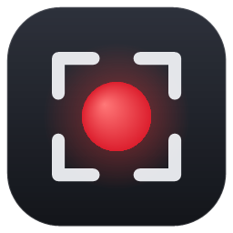

<p align="center">
  
</p>

<h1 align="center">OnAir</h1>

<p align="center">네이티브 C++로 만든 가볍고 깔끔한 다크 테마 Windows 화면 녹화 프로그램입니다.</p>

<p align="center">Author: <b>Manggdy</b></p>

<p align="center"><a href="README.md">English</a> | <b>한국어</b></p>

빨간 프레임으로 영역을 고르고 Record를 누르면, 화면과 시스템 소리를 MP4 또는 WMV로 저장합니다.

## 다운로드

[Releases](../../releases/latest) 페이지에서 최신 버전을 받습니다.

- `OnAir-Setup-<버전>.exe`: 설치 파일 (바탕 화면과 시작 메뉴에 바로 가기를 만듭니다)
- `OnAir-win-Portable.zip`: 설치 없이 사용. 압축을 풀고 `OnAir.exe`를 실행합니다.

## 주요 기능

- **원클릭 녹화**: Record / Stop 버튼 하나로 녹화를 시작하고 멈춥니다. 녹화 중에는 경과 시간이 표시됩니다.
- **녹화 영역 프레임**: 빨간 프레임의 상단 손잡이를 끌어 옮기고, 가장자리를 끌어 크기를 조절합니다. `Esc`로 숨길 수 있습니다. **Full**을 누르면 모든 모니터를 한 번에 녹화합니다.
- **시스템 소리 녹음**: 스피커로 나오는 소리를 함께 녹음합니다(WASAPI 루프백). 소리가 없는 구간이 있어도 영상과 싱크가 어긋나지 않습니다.
- **설정 창**: 포맷, 화질, 프레임 레이트, 소리를 고를 수 있고 자동으로 저장됩니다.
- **다중 모니터 지원**: 배율이 서로 다른 모니터를 오가도 녹화 프레임이 정확한 픽셀 크기를 유지합니다. 인코더 한도(4096×2304)보다 큰 영역은 비율을 유지한 채 축소해 녹화합니다.
- **업데이트 확인** (현재 꺼져 있음): 새 버전을 확인하고 설치하는 코드는 그대로 들어 있습니다. `OnAir/MainWindow.cpp`의 `StartUpdateThread()` 주석을 풀면 다시 켜집니다.

## 요구 사항

- Windows 10 또는 11 (x64)

## 사용법

### 설정

톱니바퀴 버튼으로 설정 창을 엽니다. 선택한 값은 자동으로 저장됩니다.

| 항목 | 선택지 | 기본값 |
|---|---|---|
| Format (포맷) | MP4 (H.264 + AAC), WMV (WMV9 + WMA) | MP4 |
| Quality (화질) | Low / Standard / High / Max | High |
| Frame rate (프레임 레이트) | 15 / 24 / 30 / 60 fps | 15 |
| System audio (시스템 소리) | On / Off | On |

## 데이터와 설정

| 데이터 | 위치 |
|---|---|
| 녹화 파일 | `동영상\OnAir` (기본값) |
| 설정 | `%LOCALAPPDATA%\OnAir\settings.ini` |

## 소스에서 빌드

Visual Studio 2022 (C++ 데스크톱 개발 워크로드)와 Windows 10/11 SDK가 필요합니다.

### 빌드

Visual Studio에서 [OnAir.sln](OnAir.sln)을 열고 `Release|x64`로 빌드하거나, 다음 명령을 실행합니다.

```powershell
msbuild OnAir.sln /p:Configuration=Release /p:Platform=x64
```

결과물은 `OnAir\build\Release\OnAir.exe`에 생성됩니다.

### 배포

```powershell
powershell -ExecutionPolicy Bypass -File .\scripts\Publish-Velopack.ps1
```

이 스크립트는 앱을 빌드하고 배포 폴더를 준비한 뒤, `artifacts\velopack\Releases`에 Velopack 설치 파일과 업데이트 피드를 만듭니다. `vpk` CLI가 필요합니다(`dotnet tool install -g vpk`).

### 버전 관리

버전 번호는 [`OnAir/latest-version.txt`](OnAir/latest-version.txt) 한 곳에서만 관리합니다. 빌드할 때 이 값이 앱에 들어가고, 배포 스크립트도 같은 값을 릴리스 버전으로 사용합니다.

## 프로젝트 구조

| 경로 | 내용 |
|---|---|
| `OnAir/` | 실제로 배포되는 네이티브 Win32 앱 |
| `OnAir.WinUI/` | 실험용 WinUI 3 프런트엔드 (솔루션 빌드에는 포함되지 않음) |
| `scripts/` | 릴리스 패키징 스크립트 |
| `docs/` | README용 아이콘 |

## 사용한 라이브러리

- [Velopack](https://velopack.io/): 설치 프로그램과 업데이트
